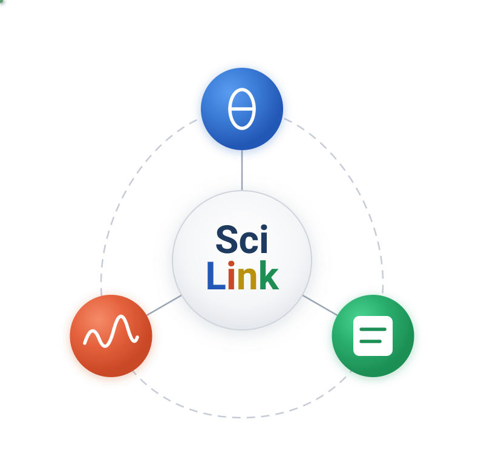
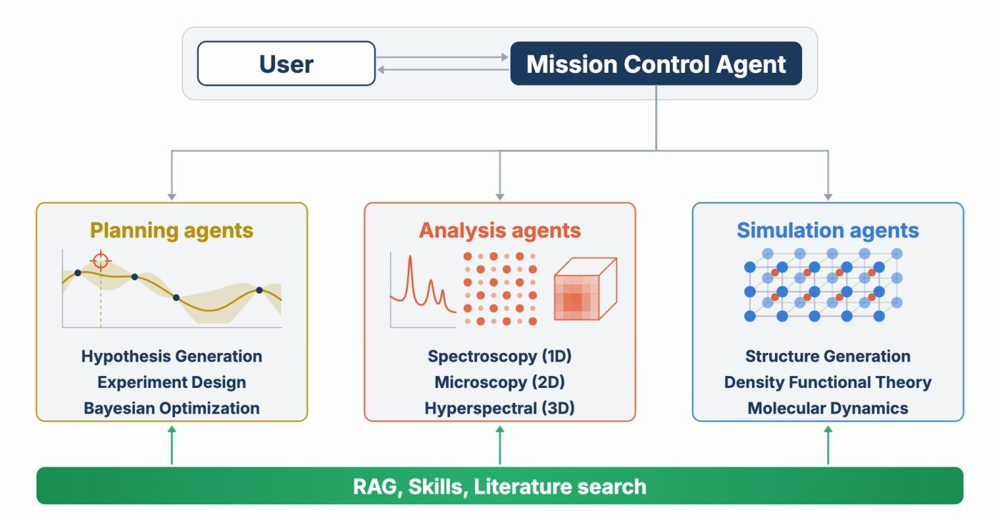
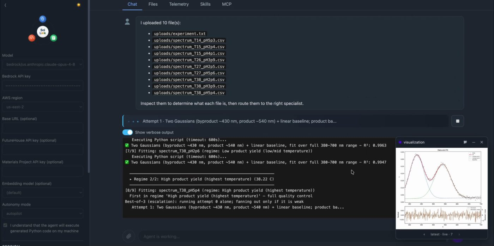
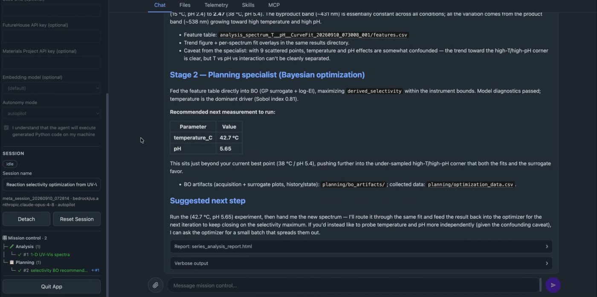
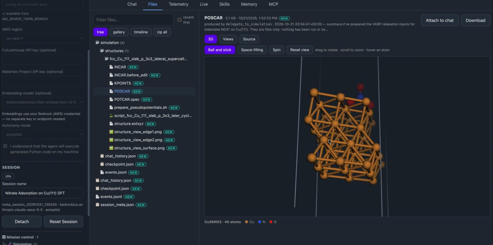
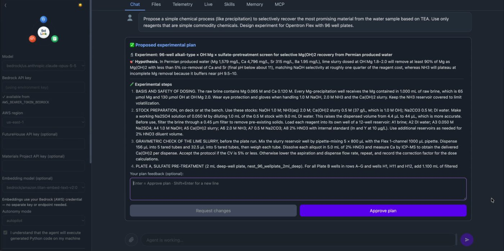
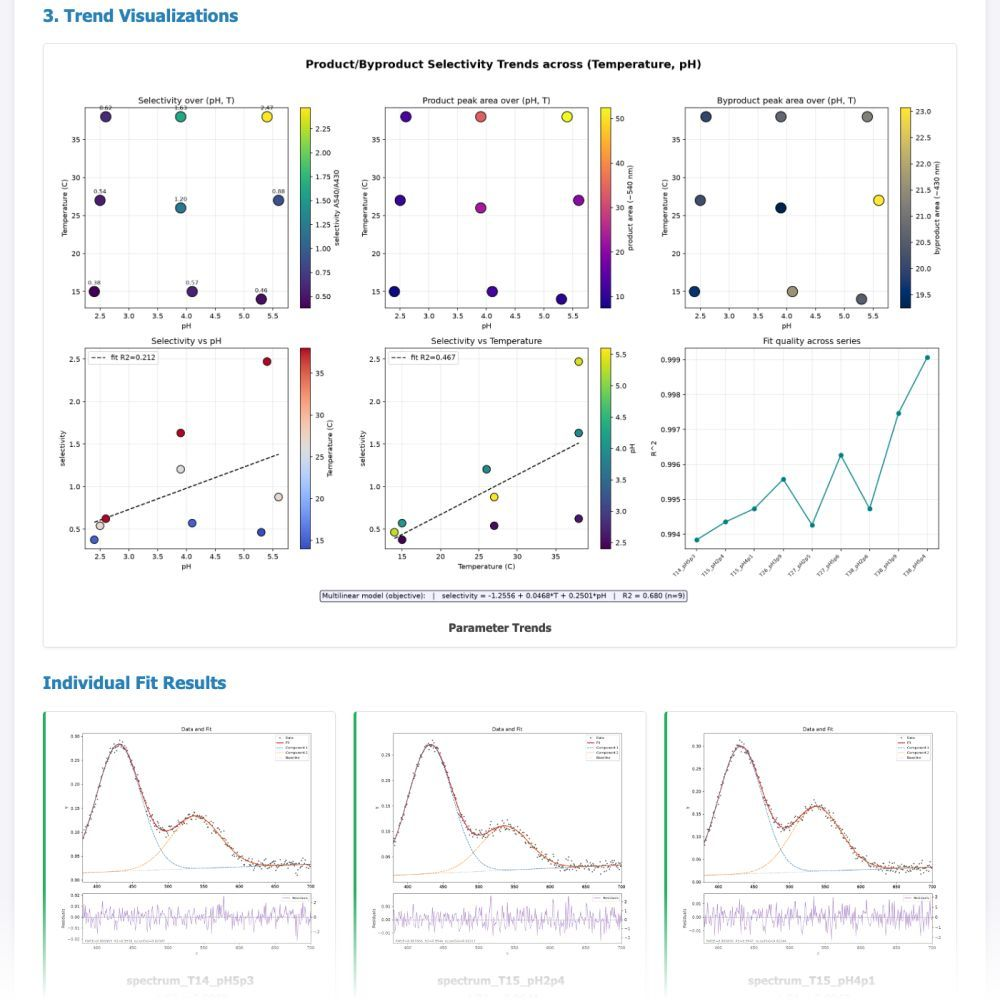
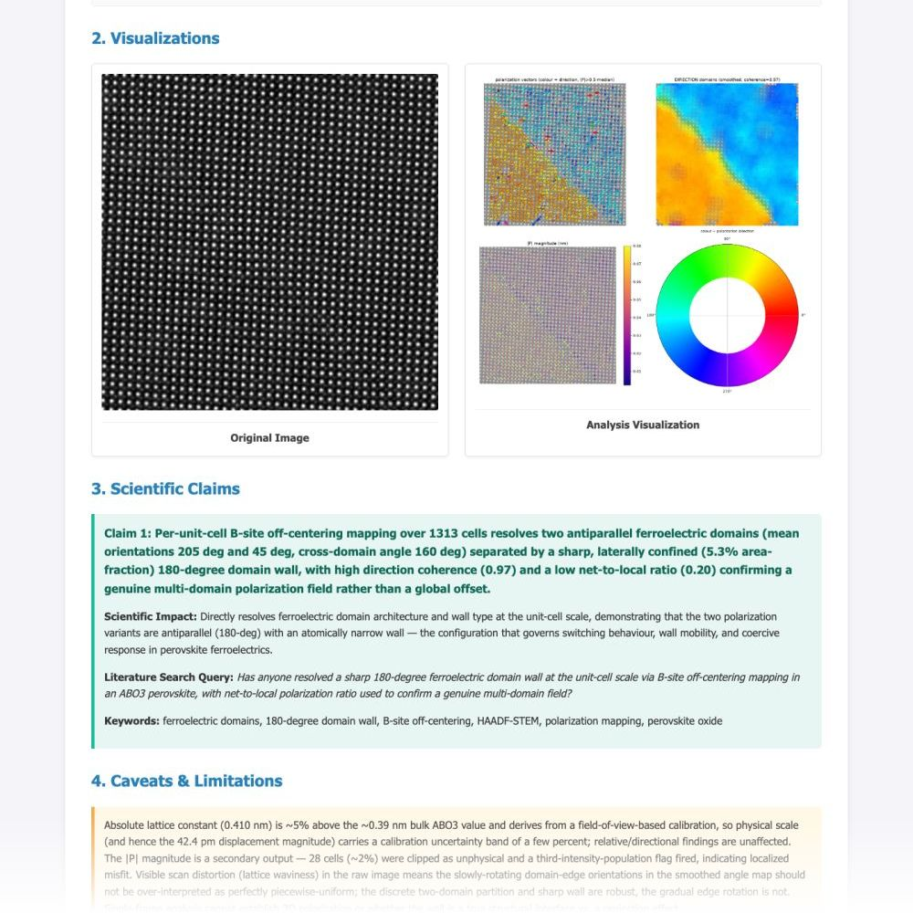
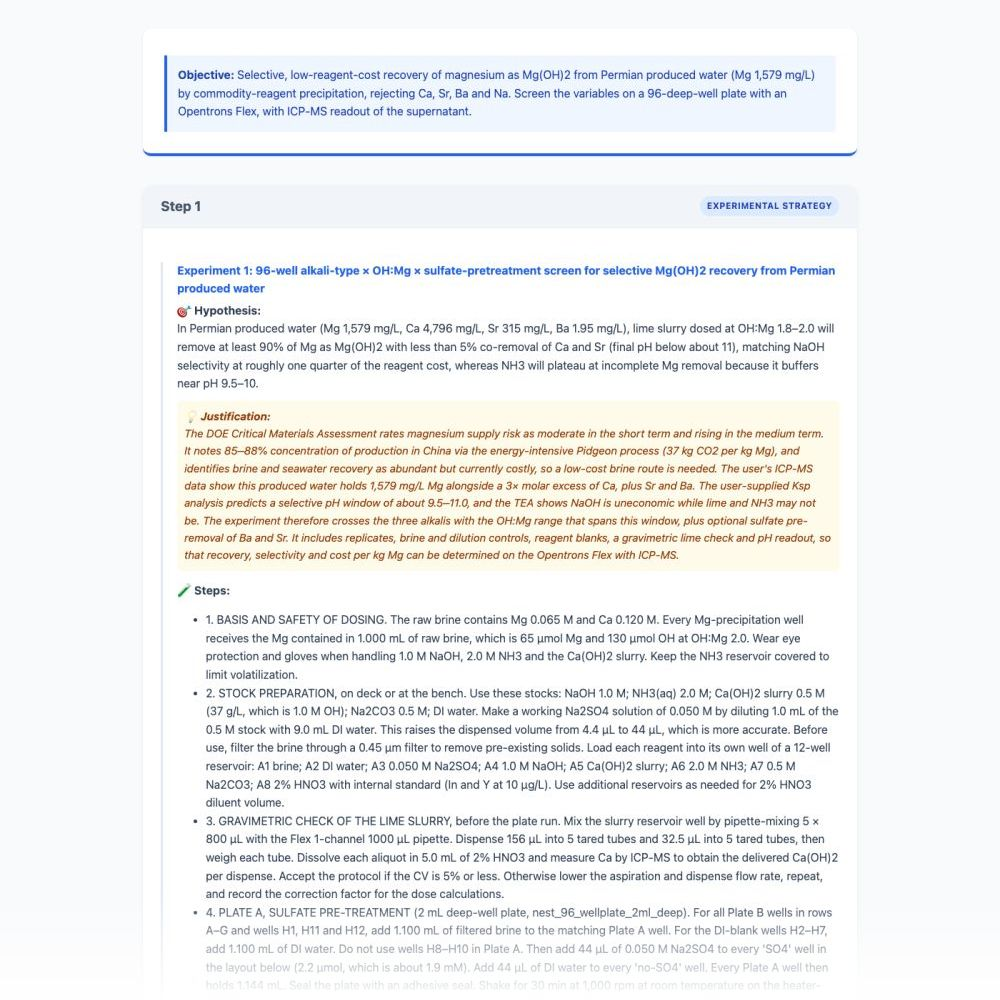

<p align="center">
  <picture>
    <source media="(prefers-color-scheme: dark)" srcset="https://raw.githubusercontent.com/ziatdinovmax/SciLink/main/misc/scilink_logo_dark_animated.svg">
    
  </picture>
</p>

# SciLink

**An agentic platform that runs your research cycle: plan, analyze, simulate.**

SciLink is **mission control** for materials and chemistry research: an agent
that takes a research task, splits it across specialist AI teams for
experimental planning and multi-modal data analysis, and connects their
results. Analysis findings feed the design of the next experiment, and that
experiment's data comes back for analysis, so a cycle that usually spans
separate tools, file formats and specialists runs as one continuous study.
Simulation agents, which bring computational modeling into the same loop, are
under active development.

You can work with SciLink in three ways. **Chat with it** in the browser or
terminal and steer as it goes. **Give it a task** from the command line or
Python and let it run to the end on its own. Or let **another AI agent**, such
as Claude Code, call it as a scientific specialist over MCP.

<p align="center">
  
</p>

---

## Quick start

```bash
pip install scilink           # core, including the web UI
pip install "scilink[sim]"    # + atomate2 VASP inputs, grain boundaries, MD analysis
```

Set a model key (any one of these):

```bash
export ANTHROPIC_API_KEY=...   # or OPENAI_API_KEY / GEMINI_API_KEY,
                               # or SCILINK_API_KEY + --base-url for an
                               # OpenAI-compatible proxy
```

Launch mission control:

```bash
scilink ui       # Mission Control in the browser
scilink          # the same agent in your terminal
```

Give it a task:

> *"Here are UV-Vis spectra across temperature and pH. Fit the product and byproduct bands, then suggest the next conditions to maximize selectivity."*
>
> *"Set up a DFT calculation for nitrate adsorbed on Cu(111) and prepare VASP inputs."*
>
> *"Propose a simple precipitation process to recover magnesium from this produced-water sample, and turn it into a protocol for our liquid-handling robot."*

Mission control decides which specialists to involve, runs them at the autonomy
level you chose, and reports back with files, figures and suggested next steps.
Run it interactively and steer, hand it a brief with `--mode autonomous` and
collect the results, or start `scilink serve` and let another agent send the
tasks.

<details>
<summary>Optional: advanced segmentation with SAM</summary>

The analysis agents work without additional dependencies, but installing Meta's
[Segment Anything Model](https://github.com/facebookresearch/segment-anything)
enables more advanced particle and grain segmentation. It is not on PyPI:

```bash
pip install git+https://github.com/facebookresearch/segment-anything.git
```
</details>

## See it in action

From measurements to the next experiment: a UV-Vis series is fitted and the
feature table goes straight into Bayesian optimization:

<table>
  <tr>
    <td width="50%"></td>
    <td width="50%"></td>
  </tr>
  <tr>
    <td><sub><b>Analysis.</b> Every spectrum fitted with a verified, locked recipe. Results appear as they come in.</sub></td>
    <td><sub><b>Planning.</b> The fitted features feed a Bayesian optimizer that recommends the next measurement.</sub></td>
  </tr>
</table>

From a plain-language request to ready-to-run inputs and protocols:

<table>
  <tr>
    <td width="50%"></td>
    <td width="50%"></td>
  </tr>
  <tr>
    <td><sub><b>Simulation.</b> The agent builds and checks the structure and writes DFT inputs ready for HPC.</sub></td>
    <td><sub><b>Experiment design.</b> Plans stop at a review gate. Approve them or ask for changes.</sub></td>
  </tr>
</table>

### Reports

Every run leaves a self-contained HTML report next to its data, figures and
scripts:

<table>
  <tr>
    <td width="33%" valign="top"></td>
    <td width="33%" valign="top"></td>
    <td width="33%" valign="top"></td>
  </tr>
  <tr>
    <td><sub><b>Spectral series.</b> Parameter trends across conditions, every individual fit, claims and caveats.</sub></td>
    <td><sub><b>Image analysis.</b> Polarization mapping of a ferroelectric STEM image, with claims and limitations.</sub></td>
    <td><sub><b>Experimental plan.</b> Hypothesis, justification, a step-by-step protocol with dose tables and plate layout.</sub></td>
  </tr>
</table>

## What it does

- **Analyze experimental data**: microscopy images, spectra (XPS, Raman, NMR,
  EELS, …) and hyperspectral datacubes, via generate–execute–verify code
  agents with domain skill bundles. A series is analysed once, then its
  verified recipe is replayed across every dataset.
- **Design and optimize campaigns**: hypothesis-driven experimental plans,
  ideation portfolios, technical documents, techno-economic assessments and
  Bayesian-optimization loops grounded in your literature and prior results.
- **Build and run simulations**: structures, DFT and classical-MD inputs
  (force field or machine-learned potential chosen automatically), engine
  execution with a self-refining fix loop, and post-run property extraction.
  *The simulation agents are under active development.*
- **Connect to lab tools**: plug in instruments, databases and other tools
  over MCP, so that, for example, an approved plan can be turned into a
  protocol a liquid-handling robot can run.

Prefer a specialist directly? Each mode is its own command:

```bash
scilink plan          # experimental design & optimization
scilink analyze       # data analysis
scilink simulate      # structures, DFT, MD
```

## What makes SciLink different

### Foundation agents

Instead of one agent per technique, SciLink ships a small set of **foundation
agents**, one per broad modality (spectra, images, datacubes, simulation
scales), specialized at runtime by pluggable **skill bundles**: a markdown file
of domain guidance, optionally with vetted helper tools. Adding a new technique
(a new spectroscopy, a new simulation engine) is a drop-in markdown bundle, not
a new agent. Domain scientists can extend the platform without touching agent
code, and the platform discovers and routes to new bundles automatically. See
[docs/foundation_agents.md](https://github.com/ziatdinovmax/SciLink/blob/main/docs/foundation_agents.md).

```bash
scilink analyze --skills ./raman_skill.md     # your expertise, one file
```

### Simulated-annealing agent pipelines

SciLink's analysis pipelines treat domain knowledge the way simulated annealing
treats temperature: hold the domain priors and the implementation plan
**locked** at first, and progressively thaw them only when verified refinement
fails to converge, with verifier-driven acceptance at every step, so a
relaxation never trades physics for fit quality silently. Inspired by
Metropolis–Hastings. See
[docs/constraint_annealing.md](https://github.com/ziatdinovmax/SciLink/blob/main/docs/constraint_annealing.md).

### Autonomy is a dial

Every mode runs at one of three autonomy levels, which decide **who holds the
acceptance gate** on agent commitments:

| Level | Who leads | Human involvement |
|---|---|---|
| **Co-Pilot** | You | Review every step |
| **Autopilot** | The agent | Approve major decisions (plans, outputs) |
| **Autonomous** | The agent | None (headless / batch use) |

The same session, tools and agents underneath. Only the gate moves.

### Grounded in what you already know

Papers, instrument manuals and prior results become **named knowledge bases**
(`scilink kb`) that any session can attach. Tabular data and record databases
are queried by generated code, with no schema to define first. Grounding is
always an explicit choice, and retrieval degrades gracefully instead of
failing. See [docs/knowledge_and_data.md](https://github.com/ziatdinovmax/SciLink/blob/main/docs/knowledge_and_data.md).

### Agents that keep what they learn

During a session, the orchestrators record recurring failure modes, non-obvious
parameter choices and domain rules. Observations worth keeping are
**graduated** into markdown skills stored under `~/.scilink/`, outside the
package, and auto-loaded on every future run. Your instance gets better at
*your* problems. Opt in with `scilink memory enable` and manage the store
with `scilink memory`.

## Use SciLink from other agents (MCP)

SciLink is both an MCP **server** (its tools driven by Claude Code, Deep
Agents, VS Code or your own framework) and an MCP **client** (external tool
servers such as instrument APIs, databases and lab robots, plugged into its
orchestrators):

```bash
scilink serve --print-mcp-json      # ready-to-paste client config, secret-free
scilink analyze --mcp stdio:arxiv:python,-m,arxiv_mcp_server
```

Tool narration streams to the client live, and sessions and background jobs survive
server restarts. See [docs/connecting_agent_clients.md](https://github.com/ziatdinovmax/SciLink/blob/main/docs/connecting_agent_clients.md)
(all clients, all deployment layouts) and
[docs/mcp_client_integration.md](https://github.com/ziatdinovmax/SciLink/blob/main/docs/mcp_client_integration.md).

## Python API

```python
from scilink.agents.exp_agents import AnalysisOrchestratorAgent

if __name__ == "__main__":
    result = AnalysisOrchestratorAgent().run_task(
        "Analyze ./stem_image.tif, identify the defects and generate scientific claims"
    )
    result["key_findings"]    # plus files_produced, summary, suggested_followups
```

Each mode orchestrator (plan / analyze / simulate) exposes this same
`run_task(task, context)` contract (one programmatic call, no conversation),
which is also how mission control itself delegates to them. The individual
agents (`CurveFittingAgent`, `BOAgent`, `StructurePipeline`, …) are importable
too. See [docs/python_api.md](https://github.com/ziatdinovmax/SciLink/blob/main/docs/python_api.md).

## Going deeper

| Topic | Where |
|---|---|
| Foundation agents, skill authoring, custom tools & agents, memory | [docs/foundation_agents.md](https://github.com/ziatdinovmax/SciLink/blob/main/docs/foundation_agents.md) |
| Annealing / constraint relaxation | [docs/constraint_annealing.md](https://github.com/ziatdinovmax/SciLink/blob/main/docs/constraint_annealing.md) |
| Knowledge bases, RAG, data query, novelty assessment | [docs/knowledge_and_data.md](https://github.com/ziatdinovmax/SciLink/blob/main/docs/knowledge_and_data.md) |
| Python API and session layouts | [docs/python_api.md](https://github.com/ziatdinovmax/SciLink/blob/main/docs/python_api.md) |
| CLI reference and terminal shell | [docs/cli_reference.md](https://github.com/ziatdinovmax/SciLink/blob/main/docs/cli_reference.md) |
| Web UI | [docs/react_web_ui.md](https://github.com/ziatdinovmax/SciLink/blob/main/docs/react_web_ui.md) |
| Connecting agent clients (MCP server) | [docs/connecting_agent_clients.md](https://github.com/ziatdinovmax/SciLink/blob/main/docs/connecting_agent_clients.md) |
| Claude Code walkthrough | [docs/claude_code_integration.md](https://github.com/ziatdinovmax/SciLink/blob/main/docs/claude_code_integration.md) |
| MCP client integration | [docs/mcp_client_integration.md](https://github.com/ziatdinovmax/SciLink/blob/main/docs/mcp_client_integration.md) |
| Custom tools | [docs/custom_tools_integration.md](https://github.com/ziatdinovmax/SciLink/blob/main/docs/custom_tools_integration.md) |

## Disclaimer

SciLink was developed at Pacific Northwest National Laboratory, operated by
Battelle for the U.S. Department of Energy. See the full
[disclaimer](https://github.com/ziatdinovmax/SciLink/blob/main/docs/disclaimer.md).
